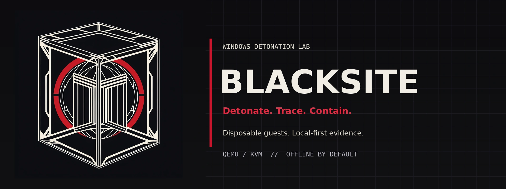

# BLACKSITE

**Detonate. Trace. Contain.**

A local Windows malware-analysis lab with a browser UI, disposable runs and evidence-first reports. Start with offline static analysis; add your own clean Windows VM when you need detonation.

- Four disposable profiles: Standard, Interactive, API Trace and Driver/BYOVD. The driver profile observes activity; it does not automatically install uploaded drivers.
- Local SHA-256, PE, YARA, strings and IOC analysis in resource-limited, networkless namespaces. Optional FLOSS, capa, ClamAV and local LOLDrivers metadata.
- Sysmon, Procmon, kernel ETW and optional Frida observations, with PCAP evidence and PDF reports. Sensor availability and gaps are reported, not assumed.
- Optional expiring, revocable, redacted report sharing and explicit hash-only reputation lookups. No automatic sample uploads.

**Windows, VM images and third-party executables are not included.** Dynamic analysis requires your own licensed Windows installation. This is not a guarantee of containment, a clean verdict or complete kernel coverage. Use a dedicated analysis host and only samples you are authorized to handle; Internet-enabled malware can exfiltrate data.

## Start here: static-only

Requirements: Linux x86_64, unprivileged user namespaces, Python 3.13+ managed by [uv](https://docs.astral.sh/uv/getting-started/installation/). Dynamic runs additionally require usable `/dev/kvm`; do not run the server as root. AppArmor or local namespace restrictions can prevent bubblewrap from working: analysis fails closed rather than falling back to an unisolated parser.

Debian/Ubuntu package examples:

```sh
sudo apt update
sudo apt install git bubblewrap util-linux

git clone https://github.com/dan098/blacksite.git
cd blacksite
uv sync --python 3.13
uv run python -m uvicorn lab.api:app --host 127.0.0.1 --port 8765
```

Open **http://127.0.0.1:8765/**. In another terminal, from the checkout, read the locally generated token with `cat data/api-token` and enter it in the UI. Do not publish it. Select **static analysis** when submitting a sample. No Windows base is needed: dynamic profiles remain unavailable until provisioning succeeds. Initial dependency installation uses the network; local static parsing does not.

Runtime files, tokens, samples, reports, tool installations and VM state stay under ignored `data/`. Keep the UI on loopback; it is not a public malware-submission service.

## Optional: desktop launcher

After `uv sync`, install user-local integration once:

```sh
uv run python scripts/install_desktop.py
```

The **BLACKSITE** application menu entry starts only `blacksite.service`, waits for the BLACKSITE health response, then opens the browser. Its **Stop BLACKSITE** action stops only that user unit. Nothing is started or enabled at installation by default; `--enable` explicitly starts it now and enables login autostart. No root privileges or additional daemon are needed. If you move the checkout, rerun the installer.
Choose an installation path without `=`, control characters or trailing whitespace; paths containing spaces are supported.

Use `--integrations` to create a private, mode-0600 `data/integrations.env` from the blank example. The unit optionally reads this file on start. Edit it locally and restart with `systemctl --user restart blacksite.service`; the example is not automatically loaded by the CLI server. For manual control: `systemctl --user start blacksite.service` / `systemctl --user stop blacksite.service`.

## Add your own Windows base

Install host VM dependencies, and ensure your user can access KVM:

```sh
sudo apt install qemu-system-x86 qemu-utils swtpm ovmf iproute2 slirp4netns nftables tshark genisoimage
```

Prepare a **new, clean Windows 11 VM**, not a personal or daily-use VM. Use UEFI and TPM 2.0, a local interactive account named **Quickemu**, and an installed, running **QEMU Guest Agent**. Do not sign in with a personal/cloud account or import personal data. Windows setup, licensing and QGA installation are your responsibility; there is no bundled OS or ready-made image shortcut.

Before taking the snapshot, verify these prerequisites with a successful **compatible cold boot**:

- NVRAM compatible with the host's **4 MiB OVMF firmware family** (`/usr/share/OVMF/OVMF_CODE_4M.fd`); this does not mean the VARS file itself must be 4 MiB.
- Boot-capable **virtio block, network and serial drivers**, available from [virtio-win](https://github.com/virtio-win/virtio-win-pkg-scripts), and QGA connected on `org.qemu.guest_agent.0`.
- An actual **Quickemu Explorer desktop session after cold boot**. Provisioning is headless: configure and verify automatic local login first, optionally using official [Sysinternals Autologon](https://learn.microsoft.com/en-us/sysinternals/downloads/autologon). Use only this disposable, nonpersonal account with unique, never-reused credentials. Do not weaken privacy checks to bypass a missing session.
- For optional Frida tracing, an already installed **guest Python 3.10+**. The dependency downloader below does not install guest Python; add `--no-frida` to bootstrap to omit tracing.

1. Obtain official, Microsoft-signed **Sysmon64.exe** and **Procmon64.exe** from [Sysinternals](https://learn.microsoft.com/en-us/sysinternals/). Accept their licenses and place them in `data/tools/guest/`. Provisioning checks their signatures; the repository never redistributes them.
2. Explicitly download the optional guest uv/Frida dependencies: `uv run python -m lab.download_guest_tools`. These host-side downloads do not upload samples.
3. **Fully shut down the source VM and its TPM process.** Keep it off throughout extraction. In a source directory containing `disk.qcow2`, `OVMF_VARS.fd` and `tpm2-00.permall`, make a cold snapshot and copy the matching UEFI/TPM state without booting between these operations:

```sh
# Replace these two paths with your own clean VM and snapshot directory.
SOURCE="/path/to/clean-windows"
SNAPSHOTS="/path/to/cold-snapshots"
qemu-img snapshot -c clean-base "$SOURCE/disk.qcow2"
mkdir -p "$SNAPSHOTS/clean-base"
cp -- "$SOURCE/OVMF_VARS.fd" "$SOURCE/tpm2-00.permall" "$SNAPSHOTS/clean-base/"
uv run python -m lab.bootstrap all \
  --source "$SOURCE" --snapshots-dir "$SNAPSHOTS" --snapshot clean-base
```

A mismatched disk, TPM or NVRAM snapshot is not a valid base. Extraction copies the source; provisioning runs a separate clone and publishes local readiness metadata only on success. Restart the API afterwards. Check readiness with `uv run python -m lab.bootstrap status`. Keep the base clean, with no personal data or reusable credentials.

### Privacy and networking

Provisioning keeps local Defender AV active, disables cloud/sample submission and pauses Windows Search hosts; the local search UI may consequently be unavailable. Review the privacy proof and sensor status in the UI/report before trusting a run. Missing evidence is not proof of absence.

Analysis profiles default to **offline**, with isolated synthetic networking. Provisioning always uses offline networking. Real Internet is an explicit opt-in: set `BLACKSITE_NETWORK=internet` for the server process, or in the optional service environment file. It requires the namespace/firewall dependencies above and per-run egress checks; host/LAN restrictions do not stop malware communicating with public destinations. Never place credentials or personal material in the guest.

## Optional tools and integrations

- Explicit local-tool downloads: `uv run python -m lab.install_tools --tools data/tools --python .venv/bin/python --allow-download`. This fetches trusted tool packages/rules and public driver-hash metadata, not driver binaries or samples. It is not required for built-in PE/YARA/hash/IOC analysis.
- Optional capa also needs compatible FLIRT signatures in `data/tools/capa-sigs`; obtain them according to the official [capa instructions](https://github.com/mandiant/capa). Missing signatures are reported as unavailable, never as a clean result.
- Hash reputation: `.env.example` documents blank keys and disabled switches. Set `SANDBOX_VT_HASH_LOOKUP=1` and/or `SANDBOX_HA_HASH_LOOKUP=1` only after deciding to disclose SHA-256 hashes to the corresponding provider; these integrations do not upload samples.
- Redacted sharing is disabled until an HTTPS public origin and separate [public gateway](lab/public.py) are configured. Redaction is not a guarantee that a report is nonsensitive. Review reports before sharing. The private API must never be exposed as the public gateway.

## Development and license

```sh
uv sync --python 3.13
uv run pytest
node --check static/app.js
node --check guest/hooks.js
```

CI runs mocked/unit tests and JavaScript syntax checks, not live VM exercises. The Python package remains `lab` and the ASGI entrypoint is `lab.api:app`.

[MIT](LICENSE) for BLACKSITE source. Windows and separately acquired tools, rules and dependencies retain their own licenses; this license grants no right to redistribute them.
